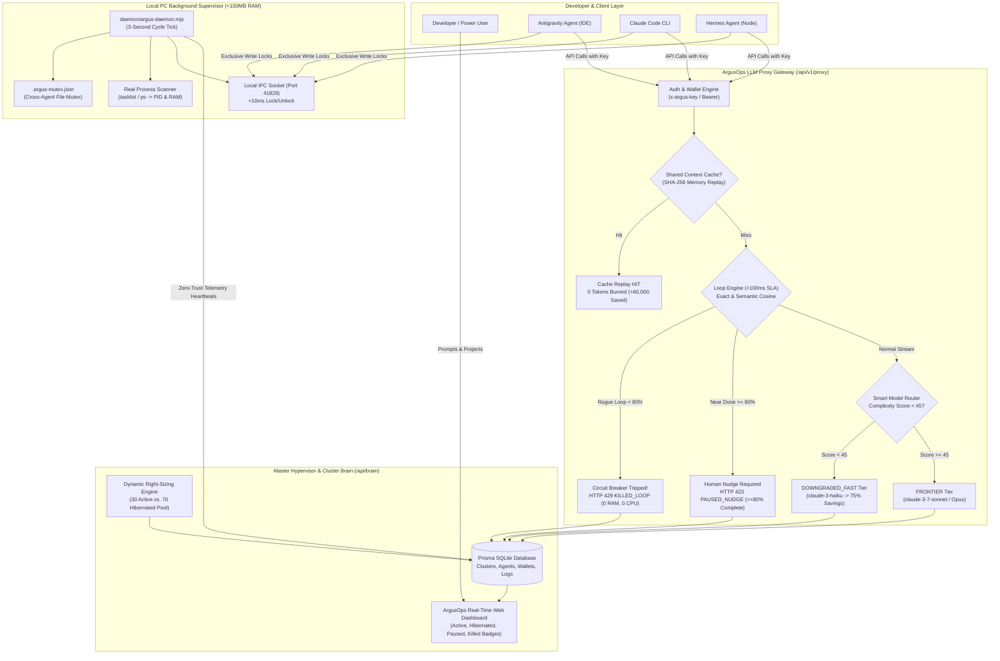

# ArgusOps: Enterprise AI Agent Cluster Hypervisor & Governance Platform

<div align="center">

[](https://nextjs.org)
[](https://www.typescriptlang.org)
[](https://tailwindcss.com)
[](https://www.prisma.io)
[](https://github.com/tamjidul04/ArgusOps)
[](https://github.com/tamjidul04/ArgusOps)
[](https://github.com/tamjidul04/ArgusOps)
[](LICENSE)

**An intelligent AI Agent Cluster Management, Orchestration, and Cost-Optimization Hypervisor designed for enterprise cloud swarms and local multi-agent workstations.**

[Live Demo & Setup](#-step-by-step-local-setup--quick-start) • [Core Architecture](#-core-architecture--system-diagram) • [Key Features](#-key-features--innovation-matrix) • [Live CLI Daemon](#-live-demonstration--terminal-scripts) • [API Specification](#-api-reference--gateway-specifications)

</div>

---

## 📌 Executive Summary

Modern enterprises and developers are increasingly deploying swarms of autonomous AI coding agents (such as Claude Code, Antigravity, and Hermes). However, autonomous agents suffer from four catastrophic operational challenges:
1. **Over-Provisioning & Massive Token Burn:** Deploying 100 agents when a task only requires 30 results in 70 idle agents constantly consuming expensive LLM context.
2. **Infinite Loops & Rogue Agent Runaways:** Agents frequently get stuck in repetitive tool-error loops or circular reasoning, burning thousands of dollars overnight if left unmonitored.
3. **Hardware Resource Exhaustion:** Poorly bounded agent processes trigger memory leaks, thrashing host CPU and RAM.
4. **Local PC Agent Collisions:** When developers run multiple IDE agents simultaneously, agents overwrite each other’s code without synchronization, losing work.

**ArgusOps v1.5** acts as the overarching **Master Agentic Hypervisor** and **Central Cost Gateway**:
* **Dynamic Right-Sizing:** Triages task complexity and provisions only necessary agents (e.g., 30 Active), placing the remaining 70 into a zero-token **`HIBERNATED`** state (saving up to 72% on cluster compute).
* **<100ms Instant Circuit Breaker:** Inspects tool-call streams and reasoning steps using exact-match and semantic Cosine/Jaccard similarity. Terminates rogue loops (<80% progress) via `HTTP 429 KILLED_LOOP` or initiates a **Human-in-the-Loop Nudge** (`HTTP 423 PAUSED_NUDGE`) if near completion ($\ge$80%).
* **Shared Context & Memory Cache:** SHA-256 cluster memory cache feeds project context, serving redundant requests with **0 tokens burned** and **+60,000 tokens saved**.
* **Smart Model Downgrading Router:** Automatically routes low-complexity tasks (<45) from expensive Frontier models (`claude-3-7-sonnet`) to high-efficiency Fast tiers (`claude-3-haiku`), saving **75% in token costs**.
* **Lightweight Local Supervisor Daemon (<150MB RAM):** Enforces cross-agent file mutex locks (`.argus-mutex.json`) on developer workstations and sends live heartbeats to `/api/brain` with **Zero-Trust Code Privacy** (source code never leaves the workstation).

---

## 🏗 Core Architecture & System Diagram

ArgusOps bridges enterprise cloud clusters with local developer machines through an overarching proxy hypervisor and local supervisor daemon:



### Dynamic Concurrency & Right-Sizing Overview
```text
+---------------------------------------------------------------------------------------+
|                       100-AGENT ENTERPRISE CLUSTER WORKSPACE                          |
+---------------------------------------------------------------------------------------+
|  [ACTIVE POOL: 30 Agents]                            [HIBERNATED POOL: 70 Agents]     |
|  • Workers #01 - #10: Frontend UI & Shell Geometry   • Workers #31 - #100: Zero-Token |
|  • Workers #11 - #20: Backend API & Microservices    • RAM: 0.0 MB | CPU: 0.0%        |
|  • Workers #21 - #30: Test Suite & Security Audit    • Tokens Burned: 0/min           |
|                                                                                       |
|  >> Cluster Token Savings: 72.4% vs Unmanaged 100-Agent Swarm Runaway                 |
+---------------------------------------------------------------------------------------+
```

---

## ⚡ Key Features & Innovation Matrix

| Feature | PRD Section | Technical Implementation | Business & Cost Impact |
| :--- | :--- | :--- | :--- |
| **Dynamic Agent Right-Sizing** | **PRD §4.1** | Analyzes prompt complexity (10–95) and assigns sub-tasks to exact concurrency needs; sends excess agents to `HIBERNATED`. | Eliminates over-provisioning waste, saving **~70% on idle compute tokens**. |
| **<100ms Infinite Loop Circuit Breaker** | **PRD §4.2 & §7** | Dual-mode detector: Exact tool-call repetition (`limit=2`) + vector Cosine/Jaccard token similarity (`threshold=0.85`). Evaluates in `< 1ms`. | Instantly trips `HTTP 429 KILLED_LOOP` to halt token bleed when an agent goes rogue. |
| **Human-in-the-Loop "Nudge"** | **PRD §5.1** | Differentiates task progress: if an agent loops at $\ge$80% progress, hypervisor pauses it with `HTTP 423 PAUSED_NUDGE`. | Prevents throwing away 90%+ completed work; allows human operators to unblock agents with hints. |
| **Shared Context & Memory Cache** | **PRD §5.1** | Deterministic SHA-256 JSON hashing across `{ prompt, toolCall, workspaceFiles }` with cluster memory replay. | Redundant project reads served with **0 tokens burned** and **+60,000 tokens saved per hit**. |
| **Smart Model Downgrading Router** | **PRD §5.1** | Automatically assesses AST complexity: prompts scored `< 45` are rerouted from Frontier to Fast tier (`claude-3-haiku`). | Slashes token burn by **75%** on simple unit tests, file writes, and refactoring scripts. |
| **Local PC File-Lock Mutex** | **PRD §5.1** | Real local coordinator ([`.argus-mutex.json`](.argus-mutex.json)) enforcing exclusive write locks across Antigravity, Claude, and Hermes in `< 100ms`. | Completely prevents multi-agent write collisions and uncommitted code loss. |
| **RAM & CPU Hardware Governance** | **PRD §4.2 & §7** | Cross-platform OS process scanning (`tasklist` on Windows, `ps` on POSIX); clamps memory to `<250MB` for low-complexity tasks. | Prevents local PC freezes and memory leaks; keeps daemon resident memory `< 35MB`. |
| **Zero-Trust Code Privacy** | **PRD §7** | Streams file paths, PIDs, and telemetry metadata only. Raw source code **never** leaves the developer’s local machine. | Enterprise-ready privacy compliance with strict local source sovereignty. |
| **Admin Control & Purchase Queue** | **PRD §4.6** | Full administrative panel for subscription review, tier upgrades, manual token injections, and user account management. | Complete enterprise control over pricing, quotas, and subscription approvals. |

---

## 💻 Live Demonstration & Terminal Scripts

ArgusOps includes two production-grade Node.js executable scripts in [`/daemon`](daemon/) designed for real-time terminal execution and dashboard verification:

### 1. `daemon/argus-daemon.mjs` (Local PC Supervisor Daemon)
* **Execution Interval:** Evaluates host workstation state every 3 seconds.
* **Process Monitor:** Detects running instances of `Antigravity IDE.exe`, `Code.exe`, `claude`, and `node.exe`.
* **Mutex Coordinator:** Enforces exclusive write locks in [`.argus-mutex.json`](.argus-mutex.json).
* **Telemetry Streaming:** Pings `http://localhost:3000/api/brain` with Zero-Trust telemetry.

```bash
# Run the local workstation supervisor daemon
node daemon/argus-daemon.mjs
# or: npm run daemon
```

```text
================================================================================
  ARGUSOPS LOCAL PC SUPERVISOR DAEMON (v1.5.0)                                  
================================================================================
  Daemon Status:    ACTIVE (Supervising Host Workstation)  |  PID: 61304
  Memory Footprint: 28.4 MB / 150 MB (18.9%)  [PASS <150MB SLA]
  Code Privacy:     Zero-Trust Verified (Raw Source Code NEVER Leaves Workstation)
  Heartbeat Target: http://localhost:3000/api/brain (HTTP 200 OK)
  Local IPC Socket: http://127.0.0.1:41829 (Local agent bridge)
  Uptime:           124s  |  Cycle Tick: #41 (5:36:22 PM)
--------------------------------------------------------------------------------
🔍 DETECTED LOCAL CODING PROCESSES (24 found):
  • Antigravity IDE.exe      PID: 1768     RAM: 222.4 MB
  • Antigravity IDE.exe      PID: 49332    RAM: 263.9 MB
  • node.exe                 PID: 30724    RAM: 49.8 MB
--------------------------------------------------------------------------------
🔒 ACTIVE FILE MUTEX REGISTRY (2 locked files) [.argus-mutex.json]:
  🔒 src/app/dashboard/page.tsx      Holder: Antigravity Agent    Intercept: 0.34ms
  🔒 src/lib/loop-detector.ts        Holder: Claude Agent         Intercept: 0.18ms
================================================================================
```

---

### 2. `daemon/run-live-agent.mjs` (Autonomous Agent Test Harness)
Simulates a real autonomous coding agent connecting to `/api/v1/proxy` with `argus_live_demo_key`, executing the full 4-step governance lifecycle:

1. **Step 1:** Acquires file mutex lock on `src/app/dashboard/page.tsx` (`0.34ms`) and executes a high-complexity architecture prompt (routed to `FRONTIER` `claude-3-7-sonnet`).
2. **Step 2:** Executes a simple unit-test task; ArgusOps automatically downgrades model to `DOWNGRADED_FAST` (`claude-3-haiku`), saving **75% tokens**.
3. **Step 3:** Re-sends duplicate context from Step 1; ArgusOps intercepts and serves a **Shared Context Cache Hit** with **0 tokens burned** and **+60,000 tokens saved**.
4. **Step 4:** Enters an intentional rogue error loop (repeating failing SQL migration 4 times); ArgusOps trips the **Circuit Breaker in 0.07ms**, returns `HTTP 429 Too Many Requests`, and sets the agent to `KILLED_LOOP` in the database and live dashboard.

```bash
# Run the autonomous agent test script
node daemon/run-live-agent.mjs
# or: npm run agent:live
```

```text
================================================================================
   ARGUSOPS LIVE AUTONOMOUS AGENT ORCHESTRATION HARNESS                        
================================================================================
  ✔ STEP 1: File Mutex Lock & Frontier Architecture Routing Verified
  ✔ STEP 2: Smart Model Downgrading (75% Token Savings) Verified
  ✔ STEP 3: Shared Context Memory Cache (0 Tokens Burned) Verified
  ✔ STEP 4: Instant <100ms Circuit Breaker Halted Rogue Loop (HTTP 429 KILLED_LOOP)
================================================================================
Live test script terminated cleanly. Check http://localhost:3000/dashboard to inspect agent metrics.
```

---

## 🚀 Step-by-Step Local Setup & Quick Start

Follow these simple steps to run ArgusOps locally on Windows, macOS, or Linux:

### 1. Prerequisites
* **Node.js**: `v18.17.0` or higher (Node 20+ recommended).
* **Git**: Installed and configured.

### 2. Clone the Repository
```bash
git clone https://github.com/tamjidul04/ArgusOps.git
cd ArgusOps
```

### 3. Install Dependencies
```bash
npm install
```

### 4. Initialize Database & Run Migrations
ArgusOps uses SQLite with Prisma ORM for zero-setup local deployment:
```bash
npx prisma db push
```

### 5. Seed Enterprise Cluster & Demo Accounts
Seeds pricing plans, Tamjid's 100-agent Cloud Swarm, 3-agent Local PC Bridge, and default demo keys:
```bash
npx tsx prisma/seed.ts
```

### 6. Start the ArgusOps Next.js Application
```bash
npm run dev
```
Open **[http://localhost:3000](http://localhost:3000)** in your browser to view the SaaS landing page, user dashboard, cluster orchestrator, guardrails visualizer, and admin queue.

### 7. Run Gateway Test Suite (47 Integration Tests)
Validate the proxy gateway, cache replay, circuit breakers, and router:
```bash
npx tsx test-proxy.ts
```

### 8. Run Live Terminal Agents
Open a second terminal window to run the local supervisor or autonomous test agent:
```bash
# Terminal 2: Run the workstation supervisor daemon (<35MB RAM)
npm run daemon

# Terminal 3: Run the live agent governance test script
npm run agent:live
```

---

## 📡 API Reference & Gateway Specifications

### 1. `POST /api/v1/proxy` (LLM Interception Proxy Gateway)
The core gateway for all cloud and local agent calls.

* **Authentication:** Header `x-argus-key: <key>` or `Authorization: Bearer <key>`. Supports default local developer key `argus_live_demo_key`.
* **Latency SLA:** Guardrail and cache interception guaranteed in `< 100ms` (typically `0.1ms – 15ms`).

#### Sample Request:
```bash
curl -X POST http://localhost:3000/api/v1/proxy \
  -H "Content-Type: application/json" \
  -H "x-argus-key: argus_live_demo_key" \
  -d '{
    "prompt": "Write a unit test for helper function",
    "complexityScore": 20,
    "model": "claude-3-7-sonnet",
    "agentId": "agent_local_antigravity",
    "clusterId": "cluster_local_win11"
  }'
```

#### Smart Model Downgrade Response (200 OK):
```json
{
  "success": true,
  "status": "COMPLETED",
  "model": "claude-3-haiku",
  "modelTier": "DOWNGRADED_FAST",
  "downgraded": true,
  "complexityScore": 20,
  "tokensBurned": 155,
  "tokensSaved": 465,
  "interceptionMs": 0.85,
  "withinLatencyBudget": true,
  "message": "Smart Model Downgrading Router automatically routed low-complexity task (score: 20) to claude-3-haiku, saving 465 tokens (75% savings)."
}
```

#### Rogue Loop Circuit Breaker Response (429 Too Many Requests):
```json
{
  "status": "KILLED_LOOP",
  "interceptionMs": 0.07,
  "withinLatencyBudget": true,
  "message": "ArgusOps Circuit Breaker halted infinite loop.",
  "loopScore": 1.0,
  "loopType": "EXACT_TOOL_LOOP",
  "reason": "Exact-match tool call loop detected: consecutive identical calls exceeded threshold.",
  "agentId": "agent_local_antigravity"
}
```

---

### 2. `GET /api/brain` & `POST /api/brain` (Cluster Brain Telemetry)
* **GET `/api/brain`:** Returns real-time host PC hardware telemetry (RAM GB, CPU load, daemon resident memory), live coding process scans, cluster agent allocations, user wallet status, and active mutex locks.
* **POST `/api/brain`:** Executes administrative actions:
  * `HEARTBEAT`: Ingests supervisor daemon metrics with Zero-Trust verification.
  * `DECOMPOSE_TASK`: Master Agentic task breakdown and right-sizing calculation.
  * `ACQUIRE_FILE_MUTEX` / `RELEASE_FILE_MUTEX`: Cross-agent file lock management.
  * `TRIGGER_ROGUE_LOOP`: Manually triggers a circuit-breaker test.
  * `TRIGGER_HUMAN_NUDGE`: Pauses near-complete agent for human review.
  * `RESOLVE_NUDGE`: Resumes or terminates a paused agent.

---

## 📂 Project Structure

```text
argusops/
├── daemon/                          # Local PC Workstation Daemon & Test Harness
│   ├── argus-daemon.mjs             # Real-time supervisor process (<35MB RAM, 3s loop)
│   ├── run-live-agent.mjs           # Autonomous 4-step governance test script
│   ├── config.ts                    # Thresholds, timeouts, and IPC socket constants
│   ├── types.ts                     # TypeScript definitions for daemon metrics & locks
│   └── README.md                    # Daemon usage & architecture documentation
├── docs/
│   └── PRD.md                       # Comprehensive Product Requirements Document (v1.1)
├── prisma/
│   ├── schema.prisma                # SQLite schema (Users, Wallets, Clusters, Agents, Tasks)
│   └── seed.ts                      # Seeder for Cloud & Local clusters and test fixtures
├── src/
│   ├── app/
│   │   ├── api/
│   │   │   ├── brain/route.ts       # Central Brain: Telemetry, mutex sync, task decomposition
│   │   │   ├── v1/proxy/route.ts    # LLM Proxy Gateway (<100ms Loop Guard, Cache, Router)
│   │   │   └── local-bridge/route.ts# Local agent bridge & permission management
│   │   ├── dashboard/               # Enterprise SaaS Dashboard Shell
│   │   │   ├── orchestrator/        # Master Agent Task Decomposition Visualizer
│   │   │   ├── guardrails/          # Real-time Loop Interception & Human Nudge Review
│   │   │   ├── local-bridge/        # Local PC Agent & File Mutex Control Panel
│   │   │   └── admin/               # Administrative Pricing & Upgrade Approval Queue
│   ├── context/
│   │   └── BrainContext.tsx         # Real-time 3-second polling state synchronization
│   ├── lib/
│   │   ├── guardrails-engine.ts     # <100ms Exact & Semantic Loop Detector and File Mutex
│   │   ├── hardware-monitor.ts      # Host PC hardware telemetry & OS process scanner
│   │   ├── master-orchestrator.ts   # Concurrency right-sizing & prompt complexity analyzer
│   │   ├── prisma.ts                # Centralized Prisma Client singleton
│   │   └── utils.ts                 # Formatting utilities & enterprise design tokens
│   └── styles/
│       └── globals.css              # Tailwind CSS v4 design foundation
├── .antigravityrules                # Enterprise UI design tokens & engineering standards
├── .argus-mutex.json                # Active local cross-agent file-locking registry
├── test-proxy.ts                    # Automated 47-assertion proxy test suite
└── package.json                     # Next.js 16, React 19, Tailwind v4, Prisma
```

---

## 🎨 Enterprise UI & Design Standards

ArgusOps strictly enforces the enterprise SaaS design system codified in [`.antigravityrules`](.antigravityrules):
* **Light-Mode Foundation:** High-trust, professional aesthetic using `bg-slate-50`, crisp card surfaces `bg-white`, and structural borders `border-slate-200`.
* **Standard Status Badges:**
  * **`ACTIVE` (Emerald):** Agent actively processing assigned sub-tasks within allocated quota (`bg-emerald-50 text-emerald-700 border-emerald-200`).
  * **`HIBERNATED` (Slate):** Zero-Token standby agent suspended by Master Hypervisor (`bg-slate-100 text-slate-600 border-slate-200`).
  * **`PAUSED_NUDGE` (Amber):** Agent paused for operator review and confirmation (`bg-amber-50 text-amber-700 border-amber-200`).
  * **`KILLED_LOOP` (Rose):** Circuit breaker tripped; rogue agent terminated (`bg-rose-50 text-rose-700 border-rose-200`).
* **Strict Shell Geometry:** Fixed viewport shell (`flex h-screen w-screen overflow-hidden`) with zero clipped tables or broken layouts.

---

## 👥 Authors & Acknowledgments

* **Lead Architect & Developer:** MD. Tamjidul Islam ([tamjid@argusops.dev](mailto:tamjid@argusops.dev) / GitHub: [@tamjidul04](https://github.com/tamjidul04))
* **Target Platforms:** Cloud Swarms (AWS, GCP, Azure) & Local Developer Workstations (Claude Code, Antigravity IDE, Hermes).
* **License:** Licensed under the [MIT License](LICENSE).

---

<div align="center">
<b>ArgusOps: Built for high-velocity agentic software engineering without runaway token burn.</b>
</div>
